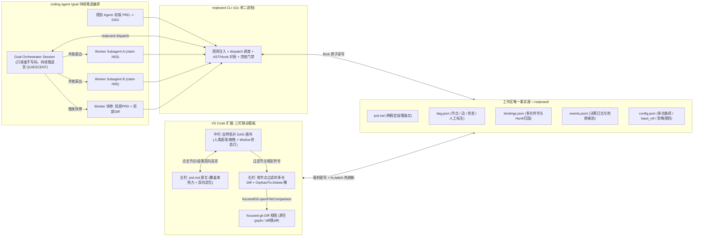
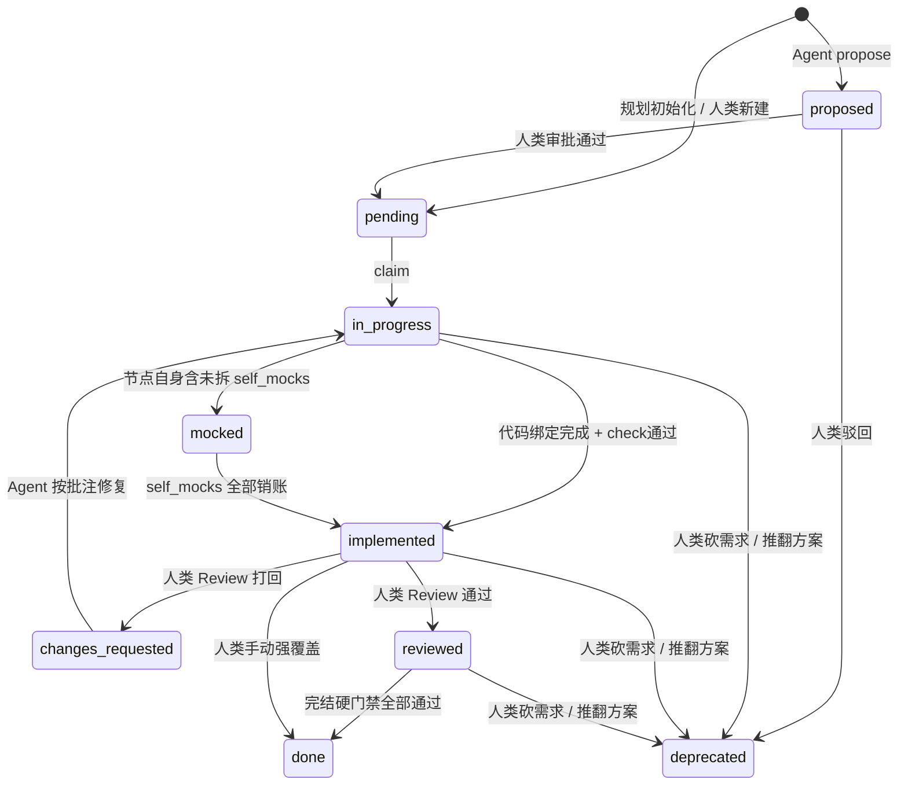
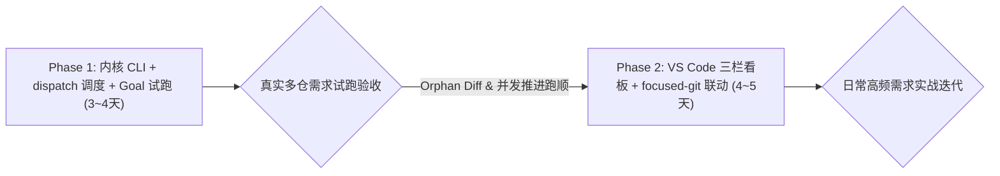

# ReqBoard 架构与协议设计稿（v1）

> **定位**：面向多仓复杂需求与多 `AI agent CLI` session 并发开发场景的**本地轻量级需求控制面与三栏 Review 看板**。
> **核心理念**：把 AI 的代码变更权从“整仓自由发挥”收拢为**“先锚定功能点再挂载改动，挂不上不给变；实施不限序，完结卡硬门禁；Review 直接 by 功能点收敛”**。

---

## 1. 核心设计原则与边界

| 原则 | 具体落地要求 |
| :--- | :--- |
| **功能/规则级拆解** | DAG 节点严格按 **业务功能 & 规则** 拆到最细，而非按仓库/接口/表拆。技术方案改了（如加枚举改拆接口、从 `service` 挪 `business`），DAG 骨架不变，只标 `stale` 并刷新挂载代码。 |
| **反碎片化** | 多段相关 PRD 锚定到同一个功能点节点（复用 `prd_refs`）；不为纯名词解释、纯复用老逻辑（0 代码改动）或并列枚举拆孤立开发节点；只为“有独立代码增量行为 / 独立验收路径”的规则建节点。外部依赖、协作者与跨节点工程 TODO（DDL / 网关配置 / Feature Flag）统一为一等前置节点（`external` / `collaborator` / `todo`），不进入主画布业务网格；仅影响单个节点的历史 `ops` 清单继续兼容。 |
| **不卡开工，只卡完结** | `mine --> mine` 依赖只卡完结、不卡开工；`external --mocked--> mine` 允许带 Mock 并行。`external|collaborator --hard--> mine` 且外部未 `done`：该节点进入 `waiting_external`，先等外部就绪或显式改 `mocked`。`todo --hard--> mine` 默认只卡下游 `done`，只有 TODO 带 `block-start` tag 时才卡 P1 开工。完结仍受 4 道硬门禁拦截。 |
| **双向孤儿拦截** | ① **左栏抓 `Unmapped PRD`**：PRD 段落没挂任何节点（含 `out_of_scope`）自动标红，防漏拆；② **右栏抓 `Orphan Diff` & `To-Delete`**：代码改动挂不上合法功能点，或已废弃节点的旧代码没删干净，自动拎出拦截。 |
| **CLI 即规则注入** | 不依赖数百行易衰减的 Prompt；通过 `reqboard` CLI 的 stdout/stderr 在最新一轮工具调用中**实时注入 PRD 原文切片、禁区列表、人工最新标注与报错纠偏指令**。 |
| **人类直写零延迟** | 页面拖拽画布、建节点、连边、改状态、写备注、Review 打回**毫秒级直写本地文件**，不经由 Agent 对话中转；人类修改拥有最高优先级并自动告警后台 Agent。 |
| **极薄自建、复用现有基建** | 零数据库、零多机同步（不引入 Dolt）；Diff 视图与多仓 Go LSP 符号跳转**直接复用现有 `focused-git` 扩展**。 |

---

## 2. 系统全景与三栏联动拓扑



---

## 3. 本地数据底座与 Schema（`<worktree>/.reqboard/`）

所有状态以纯文本落在需求 worktree 根目录的 `.reqboard/` 下（可按需 `.gitignore` 或入库跟踪），文件物理拆分以消除人机并发写冲突：

### 3.1 `prd.md`（本地 PRD 原文 + 稳定锚点）
* 初始化命令 `reqboard prd init <src.md>` 自动按标题层级与语义段落/列表项/表格行注入不可见 HTML 锚点注释（例如 `<!-- @p:3.2.1 -->`），对阅读零干扰。
* PRD 更新时运行 `reqboard prd sync <new.md>`：按标题路径 + 文本相似度自动对齐保留旧锚点 ID，输出三类精准变更：
  1. **修改段落** → 关联节点及其全部下游自动置 `stale: true`（附变更摘要）；
  2. **新增段落** → 左栏标为 `Unmapped PRD` 等待建节点或标忽略；
  3. **删除段落** → 关联节点标红提示“确认是否设为 `deprecated` 并触发残骸清理”。

### 3.2 `dag.json`（功能/规则级图谱，人类直改与状态真值源）

```json
{
  "schema_version": 1,
  "revision": 42,
  "requirement_name": "partner-order-flow",
  "nodes": [
    {
      "id": "rb-7a2c",
      "title": "线下签约单待支付前对客不可见",
      "description": "线上单待确认即对客可见；线下单仅流转至待支付后对客可见，排除未就绪态。",
      "scope": "mine",
      "status": "implemented",
      "stale": false,
      "stale_reason": "",
      "prd_refs": ["p:3.3.4-2", "p:3.3.4-3"],
      "tags": ["多仓", "需 feature flag"],
      "ops": [
        {
          "id": "op-01",
          "kind": "ddl",
          "title": "新增订单可见性索引",
          "done": false,
          "note": "上线前在订单库执行"
        },
        {
          "id": "op-02",
          "kind": "flag",
          "title": "order_visibility_v2 开关",
          "done": true
        }
      ],
      "self_mocks": [],
      "review_notes": [
        {
          "id": "rv-1",
          "author": "human",
          "status": "open",
          "target": "order_query:esdao/order_visibility_filter.go:ExcludeNotReady",
          "comment": "改用排除语义而不是白名单 include，避免后续新增状态漏掉",
          "created_at": "2026-11-16T11:29:00+08:00"
        }
      ],
      "evidence": {
        "trace_ids": [],
        "test_cases": ["TC-041", "TC-042"]
      },
      "session_id": "01a1e3c6-...",
      "hold": false,
      "attempts": 0,
      "last_error": "",
      "human_version": 5,
      "position": { "x": 420, "y": 180 },
      "updated_at": "2026-11-18T18:31:00+08:00"
    }
  ],
  "orchestrator": {
    "session_id": "01a1f800-...",
    "state": "running",
    "max_parallel": 4,
    "last_dispatch_at": "2026-11-18T18:31:00+08:00"
  },
  "edges": [
    {
      "id": "ed-9c1f",
      "from": "rb-1b0e",
      "to": "rb-7a2c",
      "kind": "hard",
      "note": "",
      "updated_by": "human",
      "updated_at": "2026-11-16T10:00:00+08:00"
    },
    {
      "id": "ed-4e8a",
      "from": "rb-2d90",
      "to": "rb-9f11",
      "kind": "mocked",
      "note": "因 AuthService 权限接口方案未确认，这条链路先用 mock 绕过",
      "updated_by": "human",
      "updated_at": "2026-11-18T21:34:00+08:00"
    }
  ],
  "ignored_prd_refs": ["p:1.1-1"]
}
```

* **节点 `scope` 枚举（防越界围栏）**：
  * `mine`：我方负责实现，允许 `claim` 和 `bind`。
  * `collaborator`：协作者负责（如同事 Alice），**禁止 Agent 修改代码**，可记录外部进度。
  * `external`：外部联调方依赖（如 AuthService / PaymentGateway / 合同），**禁止 Agent 修改代码**，用作上游依赖与 Mock 边起点。
  * `todo`：一等工程前置（DDL / 网关配置 / Feature Flag / 其他），**不是业务写码节点**；禁止 `claim` / `bind`，`done <todo-id>` 或 `node update <todo-id> --status done` 跳过代码门禁，直接完结并解锁下游。默认只阻塞下游 `done`；带 `block-start` tag 时同时阻塞 P1 开工。
  * `out_of_scope`：PRD 明确不在本期范围的红线项（如退订/退款），**硬拦截任何 `claim`/`bind`**，专门防止 AI 脑补。
* **短哈希 ID**：采用 4~6 位确定性短哈希（如 `rb-7a2c`），多 Agent 并发 `propose` 不撞车。
* **节点级 `ops` 清单（兼容保留）**：每项 `{ id, kind: "ddl"|"gateway"|"flag"|"other", title, done, note }`。仅用于只影响单个节点的轻量交付动作，看板节点编辑弹层仍可勾选/增删；跨节点、需要 1→N 阻塞的工程动作请改用一等 `todo` 节点，避免把前置依赖藏进业务节点。
* **`todo` 一等前置**：`reqboard todo add "<title>" [--kind ddl|gateway|flag|other] [--blocks <n1,n2,...>] [--note "..."]` 创建 `scope: "todo"` 节点，`--kind` 自动写入 tags，`--blocks` 自动生成 `hard` 边；`reqboard todo list [--json]` 查看完成状态与阻塞下游。看板顶部 Prerequisite Dock 统一管理 `external` / `collaborator` / `todo`。
* **一等前置 TODO 示例**：
  ```json
  {
    "id": "rb-todo",
    "title": "DDL: orders add confirmation_mode",
    "scope": "todo",
    "status": "pending",
    "tags": ["ddl"],
    "description": "上线前执行",
    "prd_refs": []
  }
  ```
  边 `rb-todo --hard--> rb-vis` / `rb-query` 表示 1→2 阻塞；默认只卡下游 `done`，`tags` 加 `block-start` 才同时卡 P1 开工。
* **误建节点删除**：`reqboard node delete <id>` 直接删除节点与关联边；若仍有 `bindings` 则默认拒绝并提示改用 `deprecate`（保留 To-Delete 残骸追踪），确认误建后加 `--force` 连同 bindings 删除。
* **撤销 / 重做**：每次写 `dag.json` / `bindings.json` / `config.json` 前自动把前态快照写入 `.reqboard/.undo/`（最多 20 步）；`undo` / `redo` 在 `flock` 内原子完成，`status --json` 返回 `undo_depth` / `redo_depth`。`reqboard init` 生成 `.reqboard/.gitignore` 忽略 `.undo/` 与 `.lock`，避免快照被当成代码改动。

### 3.3 `bindings.json`（多仓代码归因 + 并发软租约）

```json
{
  "schema_version": 1,
  "leases": [
    {
      "node_id": "rb-9f11",
      "session_id": "01a1f2bd-...",
      "patterns": ["order_service:src/application/precheck/**"],
      "claimed_at": "2026-11-19T21:27:00+08:00"
    }
  ],
  "bindings": [
    {
      "id": "bd-01",
      "node_id": "rb-7a2c",
      "repo": "order_query",
      "file": "src/repository/dal/esdao/order_visibility_filter.go",
      "granularity": "symbol",
      "symbol": "buildCustomerVisibilityFilter",
      "anchor_hint": "",
      "role": "impl",
      "why": "按 PRD 3.3.4 屏蔽线下待支付前订单的对客查询",
      "session_id": "01a1d8af-...",
      "bound_at": "2026-11-16T18:35:00+08:00"
    },
    {
      "id": "bd-02",
      "node_id": "rb-7a2c",
      "repo": "order_api",
      "file": "biz/handler/open_apis/order/search_orders.go",
      "granularity": "partial_symbol",
      "symbol": "SearchOrdersForCustomer",
      "anchor_hint": "ExcludeNotReadyAgentOrder",
      "role": "impl",
      "why": "对客查询入口透传屏蔽开关",
      "session_id": "01a1d8af-...",
      "bound_at": "2026-11-16T18:40:00+08:00"
    }
  ]
}
```

* `role` 支持 `impl`（业务实现）、`mock`（临时 Mock 代码，便于拆弹定位）、`test`（单测/验收脚本）。
* 同一公共符号（如 `CreateOrder` 老函数或公共 `model` struct）允许被多个节点以 `partial_symbol` 共享挂载，不阻塞并发。

### 3.4 `config.json`（多仓与过滤基线）
* 记录当前 worktree 包含的子仓库列表、各仓独立 `base_ref`（默认自动继承 `focused-git` 的 per-repo base 配置，未配置则回退 `origin/master`）。
* 配置**自动忽略/折叠的生成代码 glob**（默认：`**/*_mock.go`, `**/mock_*.go`, `**/*_gen.go`, `**/gen/**`, `go.sum`, `**/*.pb.go`），避免改 1 行 `.thrift` 引发几千行 `Orphan Diff` 噪声。
* 默认排除单测文件（`**/*_test.go`、`**/*.test.ts`、`**/*.spec.js`、`**/test_*.py` 等）；`exclude_tests: false` 可关闭，`include_globs` 非空时只审计命中路径（支持 `repo:path`）。
* **显式 bind 豁免默认噪声过滤**：某文件被显式 `bind`（`role: "mock"` 或 `"impl"`）后，不再被默认 `**/*_mock.go` / `**/mock_*.go` 吞掉，保证手写业务 mock 在看板可见、可拆弹；显式绑定的测试文件同样豁免 `exclude_tests`。未显式 bind 的测试/生成文件仍按默认规则排除。用户自定义 ignore glob 与 include allow-list 仍然生效。
* 过滤规则通过 `reqboard filter show|set` 维护，`status --json` / `check --json` 会回显当前生效的 `filter` 供看板展示与回填。

---

## 4. 状态机、边语义与硬门禁设计

### 4.1 边（Edge）承载链路契约，节点（Node）承载自身进度

| 边类型 (`kind`) | 画布视觉 | 语义与门禁行为 |
| :--- | :--- | :--- |
| **`hard`** | 灰色/蓝色实线 | 正常真实依赖。`mine --> mine` 不卡下游开工；`external|collaborator --hard--> mine` 且上游未 done 时卡 P1 开工；`todo --hard--> mine` 默认只卡下游完结（TODO 带 `block-start` tag 才卡 P1 开工）。无论哪种，`from` 未 `done` 时 `to` 锁死不能标 `done`。 |
| **`mocked`** | **橙色虚线 + `mock` 胶囊** | **“链路方案未定/外部未 ready，先靠 Mock 绕过”**。悬停/点击直接编辑备注（如*“因方案未确认，这条链路先 mock”*）。① Agent `claim` 下游时自动注入该备注；② **存在任意 `mocked` 入边时，下游锁死不能标 `done`**；③ 人类点击切回 `hard` 时，下游自动标 `stale` 提醒拆 Mock。 |
| **`stale`** | 黄色高亮虚线 | 上游节点方案刚改，该对接契约待重核；同样阻塞下游 `done`。 |
| **`discovered`** | 细灰点线 | 非阻断溯源边（记录 Agent 做 A 时发现的新边界 B）。 |

### 4.2 节点状态机与“实施自由、完结卡门禁”



> [!IMPORTANT]
> **`reqboard done <id>` 四道硬门禁**（面向 Agent 强制拦截，任一不满足非 0 退出；人类在 UI 上保留显式强制覆盖权）：
> 1. **前置完结**：所有入边（`hard` / `mocked` / `stale`）对应的上游节点均已处于 `done` 状态；若上游是 `todo`，错误信息会明确提示“前置 TODO 未完成”并给出 `reqboard done <todo-id>` 纠偏命令；
> 2. **零 Mock 债**：该节点所有入边均已切回 `hard`（无橙色虚线），且本节点 `self_mocks` 为空、无未清理的 `role: "mock"` 绑定；
> 3. **非陈旧 & 无未闭环批注**：`stale == false`，且 `review_notes` 中无 `status == "open"` 的未解决批注；
> 4. **代码干净**：`reqboard check --node <id>` 无 `Broken Binding`，且该节点关联符号无未归因 `Orphan Diff`。
>
> **前置节点例外**：`external` / `collaborator` / `todo` 没有我方代码，`done <id>` 与 `node update <id> --status done` 跳过上述 4 道门禁，直接记录就绪并解锁下游；`--unmock-downstream` 可同时把 mocked 出边切回 hard 并标下游 `stale`。

### 4.3 废弃节点的“残骸回收”机制
当你在画布上把一个节点标为 `deprecated`（例如推翻了 `VisibilityScope` 方案）：
* 系统**保留其历史 `bindings`**，不静默清空；
* 实时比对当前 `git diff`：只要这些 `(repo, file, symbol)` 相对 `base_ref` 仍有残留变动，它们就会一直高挂在右侧 **`[待清理残骸 / To-Delete]`** 桶里，直到代码真正回归干净才自动消红。

---

## 5. 规则注入型 `reqboard` CLI 契约

CLI 是 coding agent 操作看板的唯一入口（建议用 Go 或 Node/TS 编译为单二进制，放在 PATH 中；配合一段 ≤40 行的薄 Skill 即可驱动）。所有命令支持 `--json`，默认人类/Agent 友好的结构化文本输出，并**把操作红线内嵌在返回值和报错中**。

| 命令 | 典型用法 | 输出与规则注入设计 |
| :--- | :--- | :--- |
| **`prd init / sync`** | `reqboard prd sync ./new_prd.md` | 注入/对齐锚点；打印变动段落、自动标 `stale` 的受影响节点清单、新增的 `Unmapped PRD`。 |
| **`plan import`** | `reqboard plan import plan.json` | 校验 DAG 无环、无悬空边、每个业务叶子节点均有合法 `prd_refs`；输出 PRD 覆盖率报告。 |
| **`dispatch`** | `reqboard dispatch --max-parallel 4` | **Goal Orchestrator 核心调度原语**：确定性计算当前可并发推进的节点队列（按 P0 修复/残骸 → P1 左侧优先开发 → P2 闭环快审排序，自动规避租约冲突与熔断节点）；`external|collaborator --hard--> mine` 且外部未 done 的节点不进入 P1，归入 `waiting_external`；`todo` 节点自身不进入 P1，归入 `waiting_todo`，且 `todo --hard--> mine` 默认不卡 P1（仅 `block-start` tag 才卡）；无可推进项时返回 `QUIESCENT` 与分类阻塞清单。 |
| **`claim`** | `reqboard claim rb-7a2c --lease "order_query:src/esdao/**"` | ① 若目标为 `out_of_scope`/`external`/`collaborator`/`todo`/`proposed`/`hold`，**直接拒绝并报错**；② 成功时打印：**锚定 PRD 原文全文 + 关联 `out_of_scope` 红线 + 所有入边状态及 `mocked` 人工备注 + 未解决的 `review_notes` + `[人工最新调整]` 变更提示**。 |
| **`bind`** | `reqboard bind rb-7a2c --repo order_query --file ... --symbol ... [--partial "..."] [--role impl\|mock\|test] --why "..."`<br>`reqboard bind rb-7a2c --repo order_query --file ... --all-symbols [--keep-status] --why "..."` | 写入 `bindings.json`；若 `--why` 为空或符号在当前文件不存在，**报错并提示真实可选符号名**。`--all-symbols` 扫描该文件相对 base 的全部改动符号并一次绑定，减少大仓库逐符号调用；`--keep-status` 仅登记代码，不把 `pending` 隐式改为 `in_progress`。 |
| **`ops`** | `reqboard ops add <node_id> --kind ddl\|gateway\|flag\|other --title "..." [--note "..."]`<br>`reqboard ops toggle\|remove <node_id> <op_id>` | 兼容保留的节点级轻量交付清单；看板节点编辑弹层仍可勾选/增删。跨节点或需要 1→N 阻塞的工程动作请改用 `todo`。 |
| **`todo`** | `reqboard todo add "<title>" [--kind ddl\|gateway\|flag\|other] [--blocks <n1,n2,...>] [--note "..."]`<br>`reqboard todo list [--json]` | 创建一等 `scope: "todo"` 前置节点：`--kind` 写入 tags，`--blocks` 自动创建 `hard` 边；`todo list` 输出完成状态与阻塞下游。`done <todo-id>` / `node update <todo-id> --status done` 跳过代码门禁并解锁下游。 |
| **`node delete`** | `reqboard node delete <id> [--force]` | 删除误建节点及关联边。无 bindings 直接删；有 bindings 时默认拒绝并提示 `deprecate` 或 `--force`；`--force` 连同 bindings 与关联边一并删除。 |
| **`undo / redo`** | `reqboard undo` / `reqboard redo` | 在 `.reqboard/.undo/` 最多 20 步前态快照间回滚/恢复；写操作前自动快照，`status --json` 返回 `undo_depth` / `redo_depth`。 |
| **`propose`** | `reqboard propose --from rb-7a2c --prd-ref p:3.5-1 --title "..." --reason "..."` | 在 DAG 创建虚线 `proposed` 节点并连 `discovered` 边；输出明确指令：**“节点已提交待 owner 审批，请勿在审批前修改该部分代码”**。 |
| **`mock`** | `reqboard mock add/resolve rb-7a2c --desc "..." [--edge ed-4e8a]` | 显式登记或销账节点/边上的 Mock 债。 |
| **`filter`** | `reqboard filter show --json` / `reqboard filter set --include "src/**, *.go" --exclude "vendor/**" --exclude-tests=true` | 读写 `.reqboard/config.json` 的 Diff 过滤规则（单测排除、Include / Exclude glob），并追加 `events.jsonl`；CLI 与 VS Code 右栏共用。 |
| **`check`** | `reqboard check --node rb-7a2c` / `reqboard check --all` | **多仓真实 Diff 对账**（详见第 6 节）：<br>• `--node` 仅审计本节点健康度（避免误伤并发队友的活跃租约）；<br>• `--all` 扫全盘，列出全部 **`Orphan Diff`**、**`To-Delete 残骸`**、**`Broken Binding`**，每条均附带精确纠偏命令。 |
| **`review-pack`** | `reqboard review-pack rb-7a2c` | 导出极简数据包：`[节点 PRD 片段] + [节点关联 Diff]`，可直接喂给独立轻模型做“反膨胀/塞私货”快审。 |
| **`done`** | `reqboard done rb-7a2c --evidence "trace_id:0217..."` / `reqboard done rb-ext --unmock-downstream` / `reqboard done rb-todo` | `mine` 节点执行 4 道完结硬门禁；`external` / `collaborator` / `todo` 前置节点无我方代码门禁，可直接标记 `done`（也支持切回 `pending`）。`--unmock-downstream` 会把前置节点的 mocked 出边切回 `hard`，并把下游 `mine` 标 `stale`。失败时逐条列出缺口（如“前置 TODO 未完成：入边 `ed-4e8a` 的 TODO 节点 `rb-todo` 仍为 `pending`”）。 |

**报错即规则注入示例**（Agent 试图越界或乱标完成时的真实终端反馈）：
```text
[REQBOARD BLOCKED] 无法将 rb-9f11 (order-visibility 创单主链路) 标记为 done：
  1. [入边 MOCK 未拆] ed-4e8a (rb-2d90 AuthService 权限 -> rb-9f11): "因 AuthService 权限接口方案未确认，这条链路先用 mock 绕过"
  2. [发现 Orphan Diff] 以下 2 处改动未挂载到任何功能点（疑似越界/过度设计）：
     - order_api:pkg/ratelimit/order_limiter.go :: NewOrderRateLimiter (+68/-0)
     - order_service:src/application/visibility/fund.go :: CheckCouponLock (+42/-0)
  -> 纠偏指引：
     * 若属非 PRD 要求的过度设计，请立即回滚上述代码；
     * 若确属本需求遗漏规则，请先运行 `reqboard propose --from rb-9f11 ...` 等待 owner 批准后再挂载。
```

---

## 6. 多仓 Go AST/Hunk Diff 对账引擎

为了不依赖脆弱的行号匹配，同时兼顾速度与准确度，对账引擎采用**“Git Diff Hunk 抽取 + Go AST 符号归属”**两步法：

1. **抽取真实改动范围（三点语义）**：遍历 `config.json` 中每个子仓，先执行 `git merge-base <base_ref> HEAD` 求共同祖先 SHA，再执行 `git diff --unified=0 <merge_base>`（含已提交分支改动 + 未暂存与工作区改动 + 未追踪新文件）；`merge-base` 失败时优雅回退原 `<base_ref>`。这样 base 分支领先开发分支时，其新提交不会被误报为反向删除。随后过滤掉配置的生成文件 glob（`**/gen/**` 等），得到每个改动文件的变更行区间集合。
2. **映射到符号（Symbol）**：
   * 对 `.go` 文件：用 Go 标准库 `go/parser`（或轻量化 AST 脚本）解析顶层声明（`func` / `method` / `type` / `const` / `var` 块）的起止行号，把 diff 变更行区间精准投影到**具体被改动的符号列表**；
   * 对 `.thrift` / `.yaml` / 非 Go 文件：按文件级或正则块级（`struct` / `service` / `enum`）投影。
3. **与 `bindings.json` 做集合差运算**，实时产出 4 个桶：
   * **`Attributed`（已归因）**：命中合法活跃节点的绑定（`partial_symbol` 校验锚定关键字仍在变更块附近）；
   * **`To-Delete`（待清理残骸）**：命中 `deprecated` 节点的历史绑定且相对 base 仍有 diff；
   * **`Leased`（队友施工中）**：未正式 `bind`，但命中其他活跃 session 的 `leases` 路径，在 `--node` 局部自检中不误报；
   * **`Orphan Diff`（孤儿改动）**：其余全部裸露改动——无论是 `--all` 门禁还是右栏 UI 顶部，第一时间全量暴露。

---

## 7. DAG 驱动的持续推进器（Goal Orchestrator）与并发调度机制

为彻底消除“人肉轮询各 session、反复手动发‘继续’、反复催促并发”的痛点，每个需求工作区仅需挂起 **1 个开启 `/goal` 的长驻协调者 Session（Orchestrator）**，持续跟踪 DAG 状态并自动并发扇出推进，直至整个图进入**无法自动推进的静默态（`QUIESCENT`）**才停机汇报。

### 7.1 职责铁律：Orchestrator 只调度，绝不亲自写业务代码
* **Orchestrator（主 `/goal` session）**：上下文保持极轻，循环执行 `reqboard dispatch` → 批量拉起并发 Worker（优先原生 subagent，或 `AI agent CLI` subprocess）→ 回收 Worker 结果 → 再次 `reqboard dispatch`。
* **Worker（单节点执行者）**：每个 Worker 严格只领 **1 个 `node_id`**，在隔离聚焦的上下文里跑完 `claim → 改码/单测 → bind → check --node → 回报结果` 后即销毁，不污染主 Goal 上下文。

### 7.2 确定性调度算法：`reqboard dispatch`
**绝不让 LLM 肉眼读几百行 `dag.json` 去猜“下一步推谁、该不该停”**——全部由 `reqboard dispatch --max-parallel N` 确定性计算，返回按优先级排序的派发清单：

1. **P0（最高优先：收敛与消债）**：
   * `To-Delete` 残骸清理（人类刚标 `deprecated` 且仓里仍有残留代码）；
   * `changes_requested`（人类在看板刚 Review 打回、带具体批注的节点）；
   * `stale`（PRD 更新或上游方案刚变、或橙色 `mocked` 边刚切回 `hard` 需要拆 Mock 的节点）。
2. **P1（并行功能实施）**：
   * `scope == "mine"`、`status == "pending"`、`hold == false` 的节点；
   * **“不卡开工”的边界**：`mine --> mine` 不卡开工；`external|collaborator --mocked--> mine` 可带 Mock 并行（备注自动通过 `claim` 注入）。`external|collaborator --hard--> mine` 且外部未 `done` 时，节点不进入 P1，归入 `waiting_external`，并提示等待外部 done 或显式改 `mocked`；`todo --hard--> mine` 默认不卡 P1（DDL 未跑完也可以先写代码和单测），只有 TODO 带 `block-start` tag 时才进入 `waiting_todo` 并卡开工；
   * `todo` 节点自身永远不进入 P1 写码队列，统一归入 `waiting_todo` 前置清单；
   * 排序权重：**越靠左（入度低 / 下游扇出高）优先**，先打通核心底座和原子规则。
3. **P2（自动快审与完结收口）**：
   * `status == "implemented"` 且无活跃 `review_notes` → 派发独立轻量化 Worker 跑 `review-pack` 反膨胀预检；
   * `status == "reviewed"` 且满足全部 4 道完结门禁 → 自动执行 `reqboard done` 解锁下游。
4. **停机条件（`status: "QUIESCENT"`）**：
   * 当 `P0 + P1 + P2` 均无合法可派发项时，`reqboard dispatch` 明确返回 `QUIESCENT` 及分类阻塞账单：
     * `waiting_approval`：待你在看板批复的 `proposed` 节点；
     * `waiting_review`：已实现/过预检、待你按节点 Review 的项；
     * `waiting_external`：外部/协作者节点未就绪，或 `external --hard--> mine` 卡住开工的项；`mocked` 边只影响 done，不阻塞开工；
     * `waiting_todo`：DDL / 网关配置 / Feature Flag 等前置 TODO 未完成；默认只卡下游 done，带 `block-start` 时也卡开工；
     * `circuit_broken`：自动熔断需人工拍板的异常项。
   * Orchestrator 收到 `QUIESCENT` 后**立刻输出精简阻塞摘要（可选同步发一条精简消息到 `agent-relay`）并优雅挂起/停止**，绝不空转烧 token。

### 7.3 并发推进的三道硬保险
1. **包级租约互斥（防多 Worker 互相踩编译/踩文件）**：
   * `dispatch` 结合节点的历史 `bindings` 或预估 `repo:package` 与当前活跃 `leases` 做交集检查——**落在不同仓库/包的节点直接满并发扇出**；落在同一包/同一核心文件的节点自动串行排入下一波。
2. **单节点失败熔断（Circuit Breaker）**：
   * 节点内记录 `attempts` 与 `last_error`。若同一节点连续 2 轮因同类错误失败（如环境缺权限、外部协议不明、反复 `Orphan Diff` 无法收敛），自动移出自动调度队列并归入 `circuit_broken`，禁止 `/goal` 死磕单点耗尽上下文。
3. **人类画布操作热感知（Human Interrupt）**：
   * 每轮 `dispatch` 都会重读最新 `dag.json`：你在画布上随手做的**新增节点、点 `[批准]`、Review 打回、把 `mocked` 边切回实线、或临时勾选 `hold` 暂停某节点**，下一波调度会立刻感知并响应。

---

## 8. VS Code 三栏看板与 `focused-git` 联动方案

推荐做成**独立轻量的 VS Code 扩展（`reqboard-vscode`）**，通过标准 VS Code 命令与 `focused-git` 扩展无缝衔接，彻底省掉重写 Go 多仓 LSP 和 diff 跳 diff 的工作量：

### 8.1 三栏界面与高频人工操作

| 区域 | 承载内容 | 核心高频人类交互（全部直写 `.reqboard/`） |
| :--- | :--- | :--- |
| **顶部状态条** | Goal Orchestrator 实时运行态 | • 显示 `Running (3 workers active)` / `Quiescent (待人工介入 N 项)`；<br>• `[↩ 撤销 (N)]` / `[↪ 重做 (N)]` 显示可用步数，绑定 `Ctrl+Z` / `Cmd+Z` 与 `Ctrl+Shift+Z` / `Cmd+Shift+Z`（输入框聚焦时不拦截浏览器原生撤销）；<br>• 旧 `Ops 清单` 独立抽屉按钮已移除，DDL / 网关配置 / Feature Flag 全部收敛进顶部统一 **Prerequisite Dock**；<br>• 一键复制 `/goal` 启动命令或通过可配置的 session link（`reqboard.sessionLinkTemplate`）直达主 Orchestrator session。 |
| **左栏（PRD 原文）** | Webview 渲染 `prd.md` | • 段落左侧彩色覆盖条（已覆盖绿 / `out_of_scope` 灰 / **`Unmapped PRD` 浅红**）；<br>• 划选任意段落右键 → **“一键新建 DAG 节点并锚定”** 或 **“标为背景忽略”**；<br>• 点击任意段落 → 中栏高亮对应节点；点击中栏节点 → 左栏自动滚动高亮原文。 |
| **中栏（DAG 画布）** | Webview（原生 SVG/DOM + `reqboard layout` 自然拓扑分层） | • 主画布默认只渲染我方主干（`mine` / `proposed`），保持 100% 纯业务功能树；顶部 **Prerequisite Dock** 统一收纳 `external` / `collaborator` / `todo`，`out_of_scope` 收进红线胶囊；<br>• Dock 顶条：`前置依赖 done/total` + 类型筛选 `[全部] [外部] [TODO]` + 状态筛选 `[待就绪] [已就绪]` + `[+ 新增 TODO]` + `[隐藏/展开]` + 右侧 `红线 Out-of-Scope (N)`；<br>• `[+ 新增 TODO]` 极简浮层：标题、类型（DDL / 网关 / Flag / 其他）、可选勾选下游我方节点，回车创建并自动连 `hard` 边；<br>• 每张 TODO 卡片显示类型色标、标题、影响下游数 `→ N`、`[✓ Done]`；悬停/点击高亮全部被阻塞下游并淡化其他节点，点击卡片可编辑标题/类型/备注或删除；<br>• 主画布按**自然拓扑深度（ASAP）**左→右展开，保留真实链路长短；仅带 `milestone` / `e2e` tag 的终结业务场景节点钉在最右终列；<br>• 勾选「画布含前置」后，`board.js` 与 `reqboard layout --include-external` 把 `external` / `collaborator` / `todo` 全部排到最左 Column 0 源头列，自然融入左到右拓扑；<br>• 节点卡片以紧凑胶囊显示所挂前置：`等:DDL` / `✓DDL` / `mock:Auth`，点击直接编辑对应连线；<br>• 双击空白建节点、拖锚点连边、点击节点/边原地改状态、写备注、或勾选 `hold` 暂停自动推进；<br>• 节点编辑弹层与右栏提供 `[删除]`；无绑定直接删，有绑定弹窗区分「标为废弃」与「强制删除」；选中画布节点且非输入态按 `Delete` / `Backspace` 快捷删除，误删可 `Ctrl+Z` 一键还原；<br>• 橙色虚线（`mocked`）与节点上的前置依赖小胶囊；点击切回实线自动触发下游 `stale`；<br>• 虚线 `proposed` 节点卡片直接带 **`[批准]` / `[驳回]`** 按钮；<br>• 正在被 Worker 跑的节点带动态运行徽标，卡片显示 `scope`、`status`、跨仓 `+add/-del`、可配置的 session link 跳转链接。 |
| **右栏（按节点过滤 Diff）** | Webview 侧栏或 VS Code TreeView + 原生 Diff 编辑器 | • 顶部常驻两个警戒桶：**`[Orphan Diff (N)]`** 和 **`[To-Delete 残骸 (M)]`**；<br>• 选中任意节点 → 仅列出该节点挂载的多仓文件与符号（附带 `--why` 理由）；<br>• 点击文件/符号 → 直接调用 **`vscode.commands.executeCommand('focusedGit.openFileComparison', uri)`** 并定位到对应符号行，在熟悉的多仓 Diff 视图里继续 `diff 跳 diff` 和 `Ctrl+-` 返回；<br>• 节点卡片内置 **`[Reviewed 通过]`** 和 **`[打回 + 写批注]`**，直接写入 `review_notes` 供下一波 Orchestrator 自动派发修复。 |

### 8.2 人机并发防踩踏机制
* 所有对 `dag.json` 和 `bindings.json` 的写入均通过统一文件锁（`flock`）+ 原子 rename 完成。
* 扩展通过 `fs.watch` 监听 `.reqboard/events.jsonl`，任意 coding agent Worker 调 CLI 改了状态或新增了绑定，画布与右侧 Diff 列表在 200ms 内实时刷新。
* 人类在 UI 上修改节点/边时递增 `human_version` 并写一条 `actor: "human"` 事件；后台 Agent 下次调用 CLI 自动收到高亮提示，杜绝“人改了图、AI 按旧口径继续写”。

---

## 9. 分阶段 MVP 落地计划

遵循**“先验证防越界内核与自动推进闭环，再上可视化画布，绝不让工具反噬业务时间”**的节奏，分两期推进：



* **Phase 1（先落 `reqboard` CLI + Go AST 对账 + Goal Orchestrator 薄 Skill）**：
  1. 搭建项目骨架（建议放在 `<repo-root>`，CLI 用 **Go** 写：单二进制零运行时依赖，且原生直接用标准库 `go/parser` 做 Go AST 符号投影，极其干净）；
  2. 实现 `.reqboard/` 初始化、`prd init/sync`、`plan import`、`dispatch`（含租约互斥、熔断、QUIESCENT 判定）、`claim` / `bind` / `propose` / `mock` / `check` / `done`、`review-pack`；
  3. 写一份精简的 `reqboard` Skill（区分 Planner / Goal Orchestrator / Node Worker 三种极简动作）接入 coding agent，拿一个真实需求（或 `partner-order-flow` 抽一段）实测：**规划 Agent 拆功能级 DAG → 1 个 `/goal` Orchestrator 自动并发扇出多 Worker 推进至 `QUIESCENT` → 实测 `Orphan Diff` 拦截与完结门禁**。
* **Phase 2（落 VS Code 三栏扩展 + 联动 `focused-git`）**：
  1. 在同一仓库下增加 `vscode-ext/`（TypeScript + React Flow + ELK），直接复用 CLI 输出的 JSON 数据或直读写 `.reqboard/`；
  2. 实现顶部 Orchestrator 状态条、左栏 `prd.md` 覆盖热力与划选建节点、中栏可拖拽编辑 DAG 与边标注、右栏按节点过滤 Diff + 警戒桶 + 调起 `focusedGit.openFileComparison` 并定位行号；
  3. 视需要给 `focused-git` 补一个极小的导出接口（暴露 per-repo `baseRef` 和带目标行号打开 Diff 的参数）。

---

## 10. 待你拍板的 2 个小收口问题

1. **技术栈选型**：核心 CLI 采用 **Go**（单二进制分发方便、执行毫秒级、且直接用标准库 `go/parser` 解析你们全栈 Go 多仓的 AST 符号，零外部解析器依赖），VS Code 扩展层用 **TypeScript** 调本地 `reqboard` 二进制 + 直读写 JSON。你认可 `Go CLI + TS VS Code Ext` 这个双层组合吗？
2. **启动方式**：设计稿确认无误后，是否在 `<repo-root>` 建仓，并按你的规范把 **Phase 1（Go CLI 内核 + `dispatch` 调度 + 多仓对账 + Skill）** 交由 coding agent按这份设计稿来落地实现？
